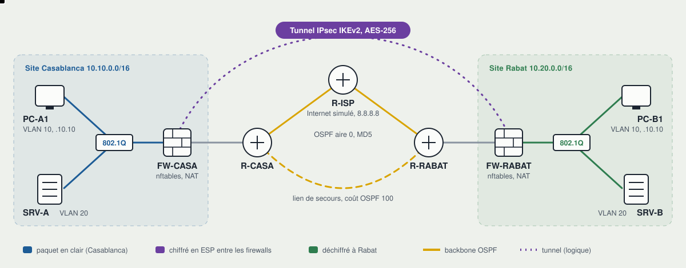

# Labo réseau et sécurité multi-sites

**Deux sites, un backbone OSPF, un tunnel IPsec, 17 tests automatiques.**
Un seul script démarre 11 équipements réseau sur une machine Linux, puis une suite de tests vérifie
le routage, le filtrage, le NAT, le chiffrement et la reprise après panne, avec des captures réseau comme preuves.

[](https://github.com/mehdi20011999/lab-reseau-securite/actions/workflows/lab.yml)



## Ce que le labo démontre

| Compétence | Mise en œuvre | Vérifié par |
|---|---|---|
| Routage dynamique | OSPF aire 0, authentification MD5, lien de secours à coût 100 | T01 à T04 |
| Segmentation | VLAN 802.1Q, trunk, routage inter-VLAN sur le firewall | T05, T09 |
| Filtrage | nftables, politique par défaut « refus », compteurs de blocage | T06 à T08 |
| NAT | NAT source vers Internet, exemption pour le trafic de site à site | T10 |
| VPN | IPsec IKEv2, AES-256, SHA-256, DH 14, clé générée à chaque démarrage | T11 à T15 |
| Haute disponibilité | Bascule OSPF sur panne franche et sur panne silencieuse | T16, T17 |
| Automatisation | Script de déploiement, tests reproductibles, intégration continue | GitHub Actions |

## Démarrer

Ubuntu 22.04 ou 24.04, Debian 12 ou WSL2 sous Windows.

```bash
git clone https://github.com/mehdi20011999/lab-reseau-securite.git
cd lab-reseau-securite
sudo ./scripts/install.sh   # FRRouting, strongSwan, nftables, tcpdump
sudo ./lab.sh up            # démarre les 11 équipements (environ 15 s)
sudo ./lab.sh test          # 17 tests + captures
sudo ./lab.sh down          # nettoie tout
```

Sous Windows : installe WSL2 avec `wsl --install -d Ubuntu-24.04` dans PowerShell (administrateur),
redémarre, ouvre « Ubuntu », puis tape les mêmes commandes. Le script détecte ce que le noyau sait faire
et s'adapte (voir [Modes d'exécution](docs/architecture.md#modes-dexécution)).

Pour explorer à la main : `sudo ./lab.sh status` ou `sudo ./lab.sh shell fw-casa`.

## Résultats

Le dernier rapport est dans [`results/RESULTS.md`](results/RESULTS.md). Extrait :

```text
T10  PASS  Accès Internet avec NAT source
           PC-A1 -> 8.8.8.8, vu sur le backbone avec la source 198.51.100.2
T13  PASS  Trafic de site à site chiffré
           10 paquets ESP, 0 paquet en clair avec adresses privées (attendu : 0)
T17  PASS  Panne silencieuse : détection par le dead-interval OSPF
           37 paquets perdus sur 150, coupure d'environ 3.7 s (dead-interval : 4 s)
```

Les preuves sont dans [`captures/`](captures) : fichiers `.pcap` pour Wireshark et leur décodage `.txt`
(adjacence OSPF signée MD5, négociation IKEv2, paquets ESP, adresse traduite par le NAT).

## Comment c'est construit

Chaque équipement est un *network namespace* Linux, avec ses interfaces, sa table de routage et son pare-feu.

| Fichier | Contenu |
|---|---|
| [`lab.sh`](lab.sh) | Création de la topologie, démarrage des démons, arrêt |
| [`scripts/tests.sh`](scripts/tests.sh) | Les 17 tests, les captures et le rapport |
| [`configs/frr/`](configs/frr) | Configuration OSPF des trois routeurs |
| [`configs/nftables/`](configs/nftables) | Politique de filtrage et NAT des deux firewalls |
| [`configs/strongswan/`](configs/strongswan) | Tunnel IPsec IKEv2 |
| [`.github/workflows/lab.yml`](.github/workflows/lab.yml) | Exécution complète à chaque `git push` |

## Documentation

- [Page de présentation](docs/index.html) : à publier avec GitHub Pages (Settings, Pages, branche `main`, dossier `/docs`).

- [Architecture](docs/architecture.md) : adressage, routage, politique de sécurité, paramètres IPsec.
- [Problèmes résolus](docs/problemes-resolus.md) : six pannes rencontrées pendant la mise au point, avec diagnostic et correction.
- [Guide d'entretien](docs/guide-entretien.md) : les questions qu'un recruteur pose sur ce projet.
- [Variante GNS3 et pfSense](docs/variante-gns3-pfsense.md) : la même architecture avec des équipements virtuels.

## Pistes d'amélioration

- Authentification IPsec par certificats (PKI) à la place de la clé pré-partagée.
- Deux tunnels pour la redondance du VPN.
- Supervision : export des compteurs nftables et de l'état OSPF vers Prometheus et Grafana.
- Version IPv6 (OSPFv3).

## Auteur

**Mehdi Ammou**, Master Réseaux informatiques et systèmes embarqués (Université Moulay Ismaïl, 2024).
[Portfolio](https://portfolio-mehdi-main.vercel.app) et [LinkedIn](https://www.linkedin.com/in/ammou-mehdi-483b6226b).
